# NetGuard 药店终端出网白名单 · 新手图文操作教程

> **Windows 7 SP1 x64** 上，从零开始完整走一遍：
> 装程序 → 生成策略 → 安装服务 → 在界面里加白名单 → 验证拦截 → 临时放行 → 看日志 → 卸载。
> 每一步都有截图，照着点就能做出来。Windows 10 / 11 的步骤完全一样，只是系统界面略有差别。
>
> 本文对应 **60 天试用版**：第一次安装/初始化时开始计时，到期后管控自动停止并恢复联网。

---

## 0. 先花两分钟搞清楚它在干什么

药店终端平时要上网（更新、远程维护），但收银/医保电脑一旦中毒，木马就可能顺着专线打服务器。
NetGuard 的做法很简单：

> **默认拒绝一切出网连接，只放行“指定程序 → 指定地址:端口”。**

- 浏览器、迅雷、聊天软件、木马：一律连不出去；
- 医保客户端访问医保前置机：正常；
- 员工是标准用户，停不掉服务、改不了策略；
- 服务一停，过滤器自动消失，**不会留下“全店断网”的事故**（失败即安全）。

三个组件：

| 组件 | 用途 |
|---|---|
| `NetGuard.exe` | 命令行：生成策略、校验、装服务、看状态、临时放行、撤销 |
| `NetGuardUI.exe` | 管理界面：日常改策略、保存并下发（推荐） |
| NetGuard 服务 | 开机自动生效；普通员工停不掉 |

---

## 1. 准备（5 分钟）

### 1.1 系统必备

1. 一台 Windows 7 SP1 / Windows 10 / Windows 11 终端，**本地管理员账户**。
2. 部署包里的 4 个文件，统一放到 `C:\NetGuard`：

   ```
   NetGuard.exe
   NetGuardUI.exe
   install-netguard.ps1
   uninstall-netguard.ps1
   ```

3. 业务信息（需要提前搞清楚）：

   | 需要确认 | 示例 |
   |---|---|
   | 业务服务器地址 | `10.10.10.10` |
   | 端口 | `8000-8005` |
   | 协议 | `TCP` |
   | 业务程序完整路径 | `C:\Program Files\YB\YbClient.exe` |

### 1.2 维护

装好后默认是**断网**状态，远程桌面/远程软件可能连不上。上线前先约定好：

- 现场有人：直接在本机操作；
- 现场没人：提前把维护电脑加进白名单，或者到场后用界面的「临时放行」。

> ⚠️ 建议先在备用机或虚拟机里跑通，再上生产终端。

---

## 2. 登录，打开“管理员”命令提示符

用管理员账户登录 Win7，看到桌面：

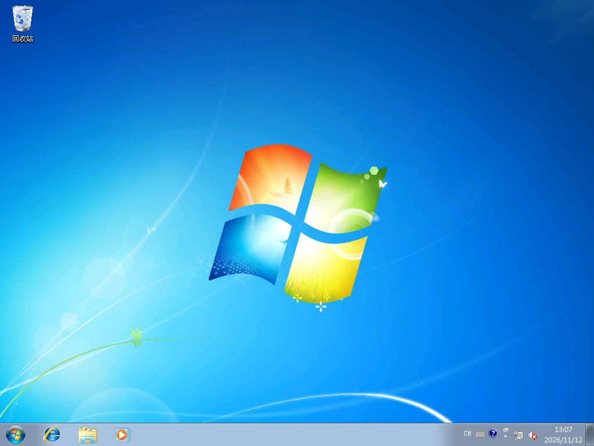

点左下角「开始」→「所有程序」→「附件」→ 找到「命令提示符」→ **右键 → 以管理员身份运行**：

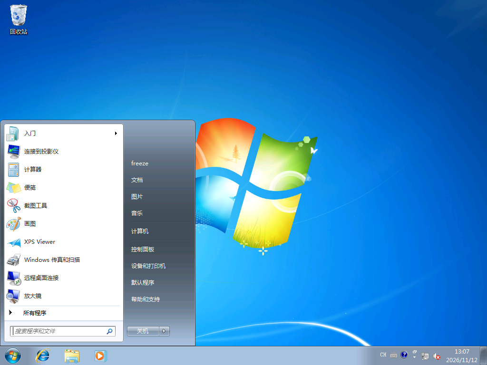

弹出 UAC 时点「是」。(如何判断是否成功了？看窗口标题，**以「管理员:」开头**就对了)。

> 小技巧：也可以在开始菜单的搜索框里输入 `cmd`，再右键选「以管理员身份运行」。

---

## 3. 程序、帮助简介

先进入目录，确认文件都在：

```bat
cd /d C:\NetGuard
dir
```

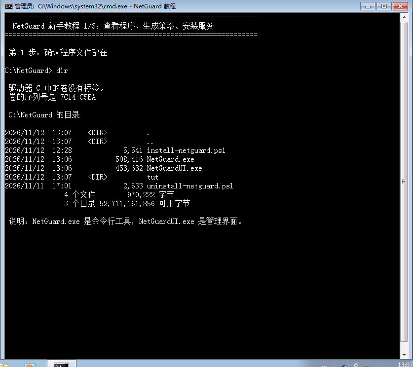

四个文件的用途：

| 文件 | 用途 |
|---|---|
| `NetGuard.exe` | 命令行工具（下面最常用） |
| `NetGuardUI.exe` | 图形管理界面 |
| `install-netguard.ps1` | 一键安装（建密钥、校验策略、装服务） |
| `uninstall-netguard.ps1` | 一键卸载（先撤销策略再删服务） |

直接运行 `NetGuard.exe` 可以看全部命令：

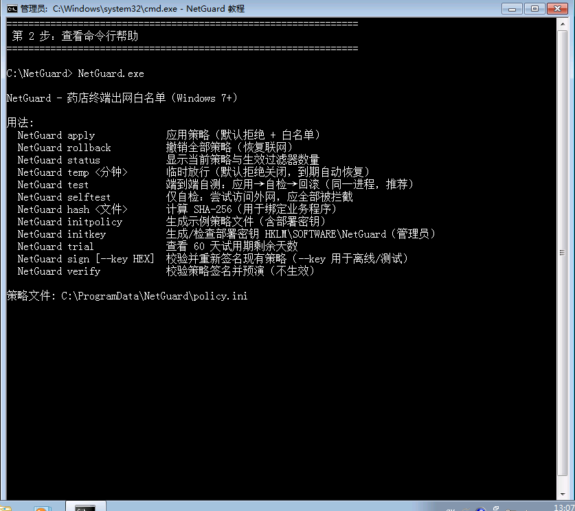

常用以下 5 个：

| 命令 | 作用 |
|---|---|
| `NetGuard.exe test` | 端到端自测（会临时断网几秒，然后自动恢复） |
| `NetGuard.exe status` | 查看当前策略和生效的过滤器条数 |
| `NetGuard.exe ctl temp 30` | 临时放行 30 分钟 |
| `NetGuard.exe ctl apply` | 立即恢复管控 |
| `NetGuard.exe ctl rollback` | 撤销全部策略（恢复联网） |

---

## 4. 生成示例策略和部署密钥

```bat
NetGuard.exe initpolicy
NetGuard.exe initkey
```

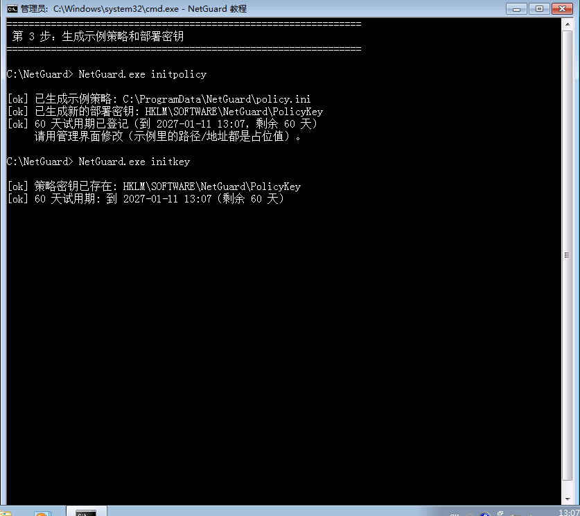

这一步做了：

1. 生成策略文件 `C:\ProgramData\NetGuard\policy.ini`；
2. 生成一台机器一个的部署密钥，保存于
   `HKLM\SOFTWARE\NetGuard\PolicyKey`（只有 SYSTEM 和管理员能读）；

> 密钥的作用：策略文件带 HMAC 签名。员工（标准用户）既改不了文件，也拿不到密钥；
> 即使用记事本改了内容，签名也会失效，服务和命令行都会**拒绝下发**（fail-closed）。

---

## 5. 策略文件（示例）

```bat
powershell -NoProfile -Command "Get-Content C:\ProgramData\NetGuard\policy.ini -Encoding UTF8"
```

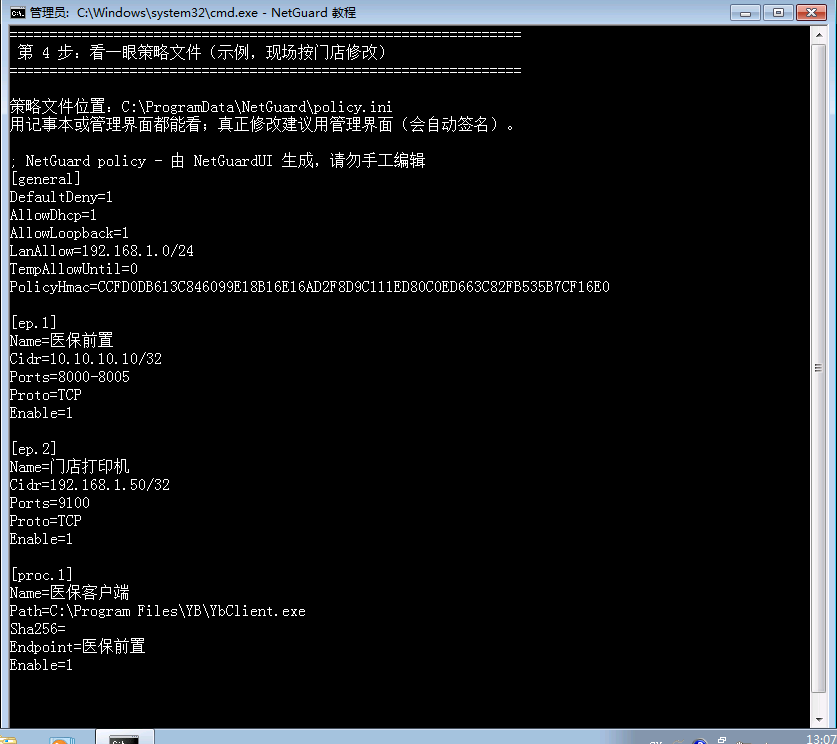

三段结构：

```ini
[general]
DefaultDeny=1            ; 1=默认拒绝（核心）
AllowDhcp=1              ; 放行 DHCP，否则拿不到 IP
AllowLoopback=1          ; 放行本机回环
LanAllow=192.168.1.0/24  ; 可选：放行门店内网
PolicyHmac=...           ; 程序生成的签名，别动

[ep.1]                   ; 业务地址
Name=医保前置
Cidr=10.10.10.10/32
Ports=8000-8005
Proto=TCP
Enable=1

[proc.1]                 ; 业务程序（只有它能访问上面的地址）
Name=医保客户端
Path=C:\Program Files\YB\YbClient.exe
Sha256=
Endpoint=医保前置
Enable=1
```

> ⚠️ **不要用记事本直接改这个文件。** 手工改完签名就失效了。
> 日常请用管理界面修改（保存时自动重新签名）。
> 确实需要手改时，改完要让管理员执行一次 `NetGuard.exe sign`。

示例里的 `10.10.10.10`、`C:\Program Files\YB\YbClient.exe` 都是**占位值**，现场要换成真的。

---

## 6. 校验策略 + 端到端自测

先只校验、不下发：

```bat
NetGuard.exe verify
```

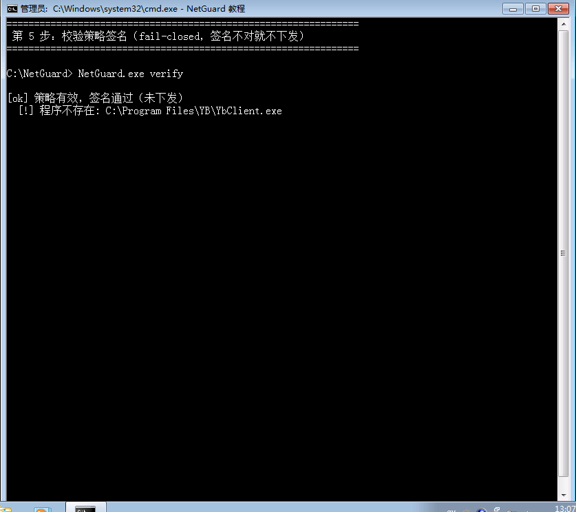

- `[ok] 策略有效，签名通过`：可以继续；
- `[!] 程序不存在`：示例路径是占位值，正常。后面在界面里换成真实程序即可。

再跑一次端到端自测（**会临时断网几秒**，自动恢复）：

```bat
NetGuard.exe test
```

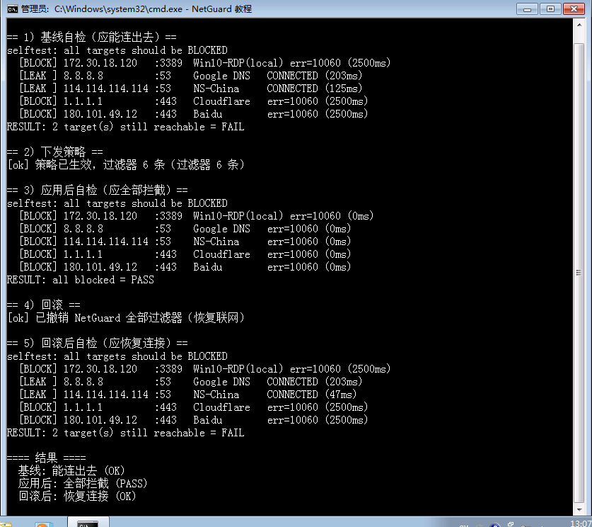

看最后三行结论就行：

```
基线：能连出去 (OK)        ← 装之前确实能上网
应用后：全部拦截 (PASS)    ← 策略真的生效了
回滚后：恢复连接 (OK)      ← 撤销后真的能恢复
```

> 中间那行 `RESULT: 2 target(s) still reachable = FAIL` 是**基线阶段**的正常输出，
> 意思是“还没装策略，当然能连出去”。以最后的总结为准。

---

## 7. 安装成系统服务

```bat
powershell -ExecutionPolicy Bypass -File install-netguard.ps1
```

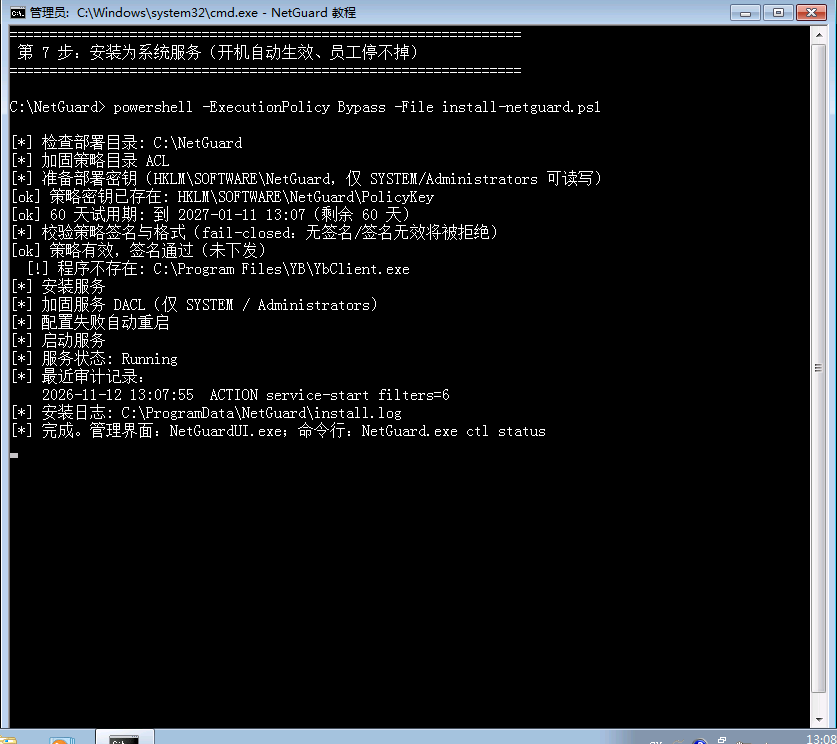

脚本会依次完成：

1. 收紧策略目录权限（普通用户只读）；
2. 生成/检查部署密钥；
3. 校验策略签名；
4. 安装 NetGuard 服务（LocalSystem，开机自启）；
5. 收紧服务权限（普通用户不能启停）；
6. 配置崩溃自动重启（5 秒 / 15 秒 / 60 秒）；
7. 启动服务并打印自检摘要。

看到 `服务状态: Running` 就成功了。

> Win7 自带的是 PowerShell 2.0，本脚本已经按 2.0 兼容写法处理，直接运行即可。

---

## 8. 确认服务与过滤器

```bat
sc query NetGuard
NetGuard.exe status
```

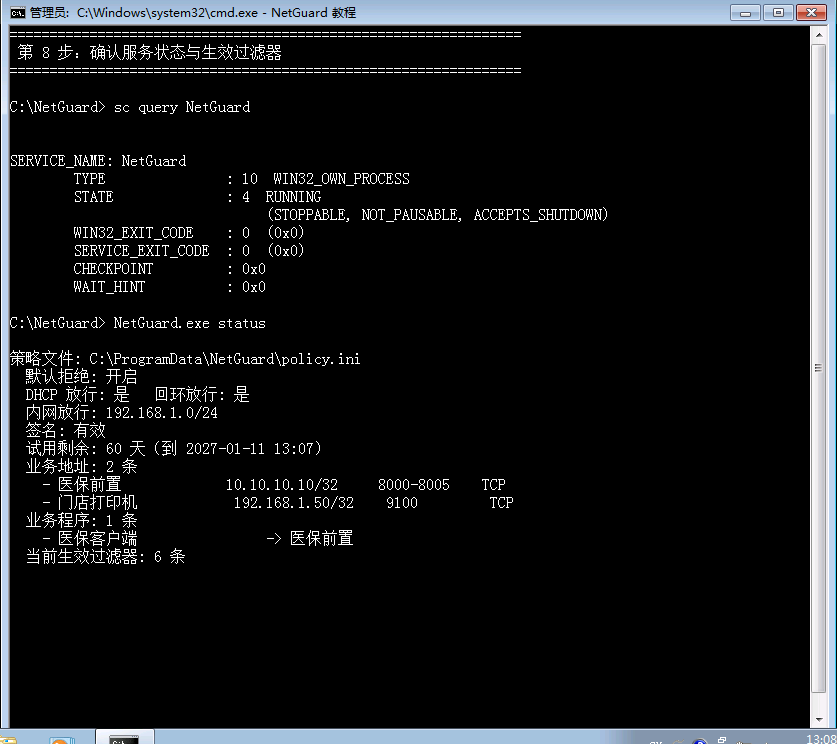

`status` 里重点看：

- **默认拒绝：开启**
- **签名：有效**
- **当前生效过滤器：N 条**
- **试用剩余：N 天（到 某年某月某日）**

本例是 **6 条**，构成是：

```
默认拒绝 IPv4 + IPv6        2 条
回环放行 IPv4 + IPv6        2 条
DHCP 放行                   1 条
内网放行 192.168.1.0/24     1 条
业务放行                    0 条（示例程序路径不存在）
```

等会儿在界面里加一个真实存在的业务程序，就会变成 **7 条**。

### 8.1 试用期

当前使用的是 **60 天试用版**。第一次执行时登记开始时间。

查看剩余天数：

```bat
NetGuard.exe trial
```

输出示例：

```
版本: 60 天试用版
试用开始: 2026-11-12 13:20
试用到期: 2027-01-11 13:20
[ok] 试用有效，剩余 60 天。
```

到期后：

- 服务每 30 秒检查一次，到期会**自动撤销过滤器、恢复联网**（不会把门店锁在断网状态）；
- `apply` / `temp` / `selftest` 会拒绝执行并提示“试用已到期”；
- 主界面底部状态栏显示“试用已到期：管控已停止，终端保持联网”；
- `rollback` / `status` / `uninstall` 始终可用，方便恢复和卸载。

续期请更换正式授权版本（替换 exe 重新安装即可，策略文件可以保留）。

脚本/监控里也可以直接读状态：`NetGuard.exe ctl status` 会多出
`trial_valid=1`、`trial_expired=0`、`trial_days=60` 三行。

---

## 9. 打开管理界面，第一次设置口令

双击 `C:\NetGuard\NetGuardUI.exe`（它内嵌了管理员清单，会自动申请提权；弹 UAC 时点「是」）。

第一次打开会让你设置管理员口令：

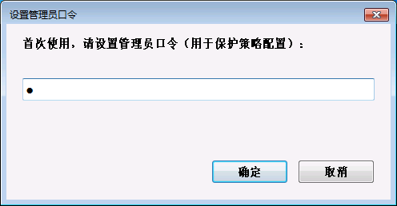

再输入一遍确认：

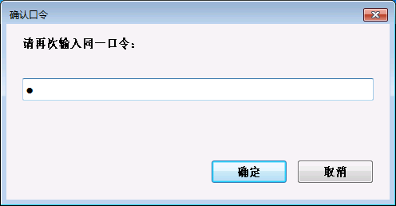

- 口令不会明文保存：`admin.dat` 里是随机盐 + HMAC-SHA256 校验值，只有 SYSTEM/管理员能读；
- 示例用 `1`，**现场一定要改成强口令**；
- 忘了口令：用管理员删掉 `admin.dat`，下次打开会重新设置（策略不受影响）。

> ⚠️ 正式版使用了更加安全的方式设置和管理口令

---

## 10. 认识主界面

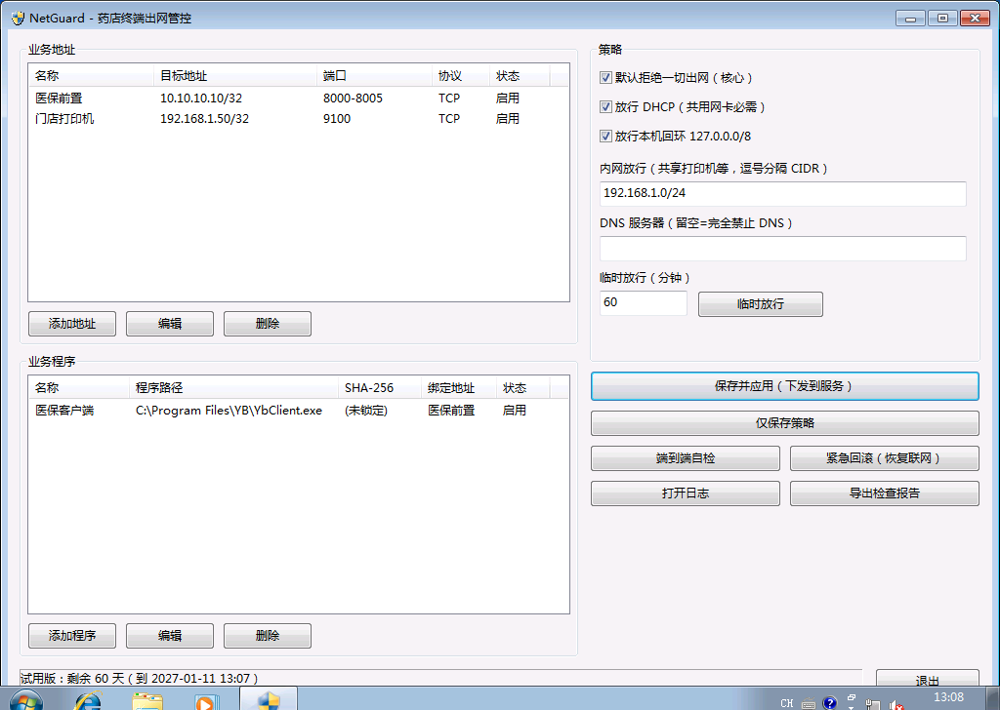

从左到右、从上到下：

| 区域 | 说明 |
|---|---|
| **业务地址** | 允许访问的“地址 + 端口 + 协议” |
| **业务程序** | 允许发起连接的 exe（可绑定 SHA-256） |
| **策略** | 默认拒绝、DHCP、回环、内网网段、DNS、临时放行 |
| **保存并应用** | 写策略 + 重新签名 + 通知服务立即下发（日常用这个） |
| **仅保存策略** | 只写文件，不立即下发 |
| **端到端自检** | 同命令行 `test` |
| **紧急回滚** | 立即撤销全部过滤器，恢复联网 |
| **临时放行** | 填分钟数，到期自动恢复 |
| **打开日志 / 导出检查报告** | 排障用 |
| **底部状态栏** | 试用剩余天数 / 到期提示 / 最近一次操作结果 |

---

## 11. 添加一条业务地址

点「业务地址」下面的「添加地址」，按四元组填：

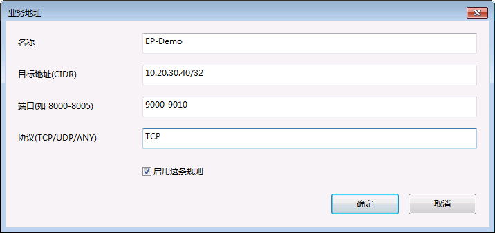

示例：

| 字段 | 值 | 说明 |
|---|---|---|
| 名称 | `EP-Demo` | 自己认得就行（现场可以用中文） |
| 目标地址(CIDR) | `10.20.30.40/32` | 单台服务器写 `/32`；整段写 `/24` |
| 端口 | `9000-9010` | 单个端口写 `443`；多个用逗号 `80,443` |
| 协议 | `TCP` | 可选 `TCP` / `UDP` / `ANY` |

填完点「确定」。

> 地址/端口/协议只要有一项格式不对，保存时整条策略会被拒绝，
> **不会**悄悄变成“所有端口都放行”。

---

## 12. 添加业务程序（并锁定哈希）

点「业务程序」下面的「添加程序」：

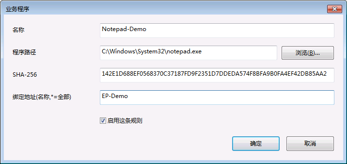

| 字段 | 值 |
|---|---|
| 名称 | `Notepad-Demo` |
| 程序路径 | `C:\Windows\System32\notepad.exe`（本例用记事本演示；现场填业务 exe） |
| SHA-256 | 点「浏览」选 exe 会自动算；也可以 `NetGuard.exe hash <文件>` 得到 |
| 绑定地址 | `EP-Demo`（或 `*` 表示所有业务地址） |

**为什么一定要绑哈希？**

白名单是“程序 + 地址 + 端口”四元绑定。如果只认文件名，木马把 `YbClient.exe` 替换掉就能借用白名单。
绑定 SHA-256 后，文件一被替换，服务在 30 秒内会撤销这条白名单并记审计日志。

> 业务程序升级后哈希会变，需要在界面里重新选一次程序并保存（或重新算哈希填进去）。

---

## 13. 保存并应用

点右侧大按钮「保存并应用（下发到服务）」，看底部状态栏：

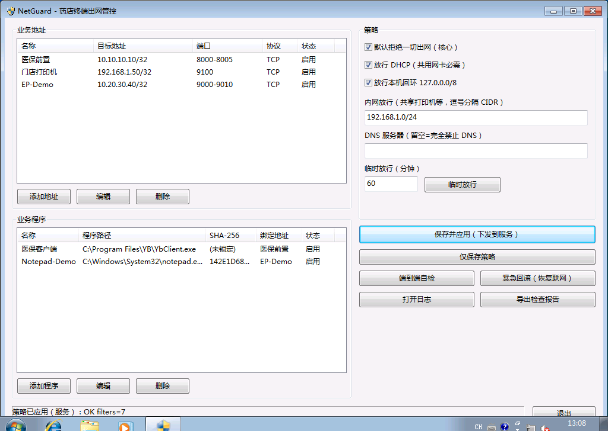

出现 `策略已应用（服务）：OK filters=7` 就成功了。

- **保存** = 把界面内容写回 `policy.ini`，并用本机密钥重新签名；
- **应用** = 通过命名管道通知服务，立即重建 WFP 过滤器；
- 员工是标准用户，既改不了文件，也连不上服务的管理管道。

---

## 14. 验证：真的断网了吗？

回到管理员命令提示符：

```bat
ping 8.8.8.8
ping 114.114.114.114
```

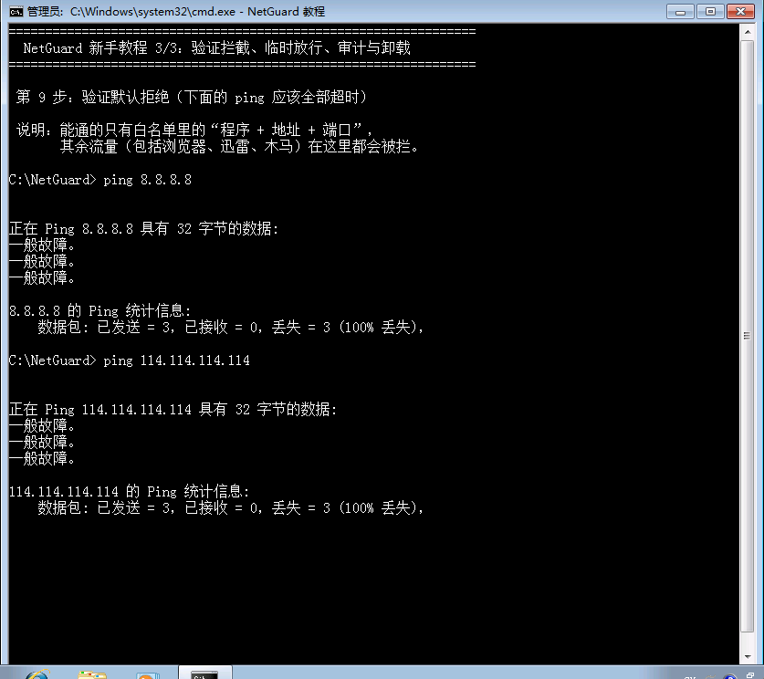

结果是「一般故障」、`100% 丢失`。默认拒绝没有放行 ICMP，所以 ping 也一起被挡。

再验证“业务仍然能通”：

- 用业务程序（本例 `notepad.exe` 不行，它不会发起网络连接；现场用医保客户端）访问业务地址，应当正常；
- 换浏览器访问同一个 `10.20.30.40:9000`，应当失败。
  因为白名单是**程序 × 地址 × 端口**，换个进程照样拦。

> ping 用的是 ICMP，NetGuard 控制的是 TCP/UDP 连接；
> 这里能 ping 不通，说明默认拒绝已经把“没有明确放行的流量”全部挡住了。

---

## 15. 临时放行（给更新程序 / 远程维护用）

命令行方式（单位：分钟）：

```bat
NetGuard.exe ctl temp 1
NetGuard.exe ctl status
```

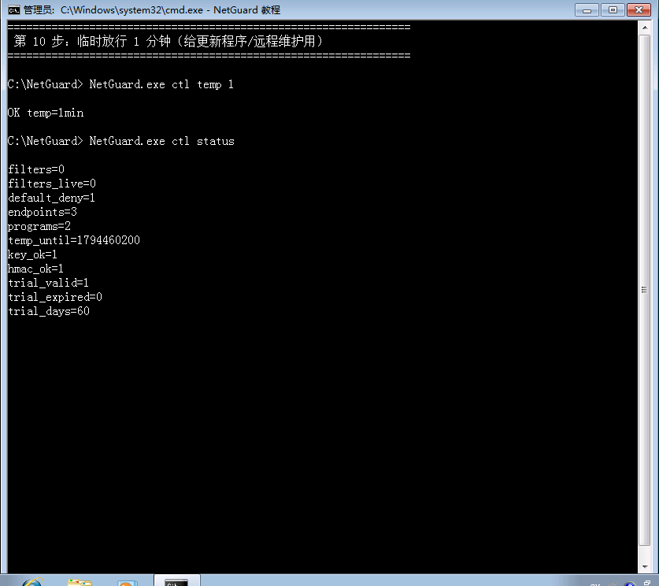

看到 `OK temp=1min`，并且 `filters=0 / filters_live=0`，说明拒绝规则已经撤下，终端临时恢复联网。
界面上的「临时放行」按钮效果一样。

> ⚠️ 临时放行期间等于**没有管控**，用完不要放着不管。

等它自己到期即可。服务每 30 秒检查一次，到期自动恢复：

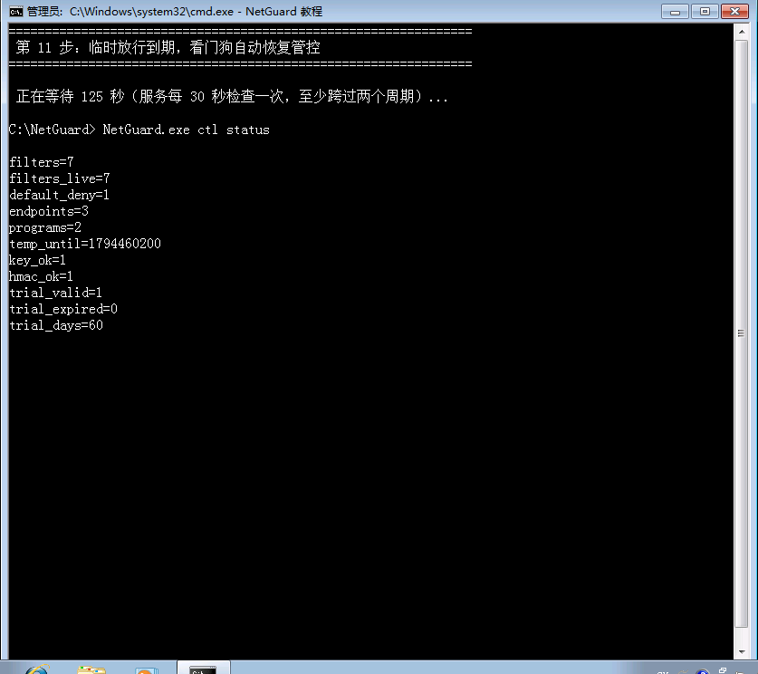

`filters_live=7` 回来了，无需人工干预。
想立刻恢复也可以执行：

```bat
NetGuard.exe ctl apply
```

---

## 16. 看审计与日志

```bat
type C:\ProgramData\NetGuard\filters.txt
powershell -NoProfile -Command "Get-Content C:\ProgramData\NetGuard\ng.log -Encoding UTF8 | Select-Object -Last 8"
```

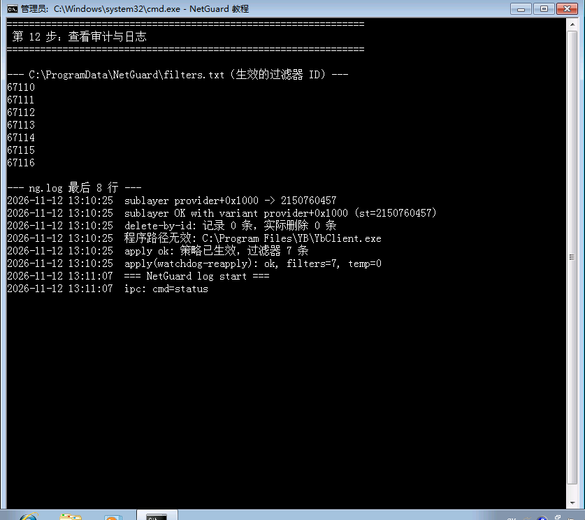

| 文件 | 内容 |
|---|---|
| `filters.txt` | 当前生效的 WFP 过滤器 ID（一条一行，本例 7 条） |
| `ng.log` | 运行日志：apply/rollback、看门狗重建、哈希变化等 |
| `audit.log` | 关键动作审计：服务启动、策略下发、临时放行、回滚、程序哈希变更 |
| `install.log` | 安装脚本的完整输出（排障先看它） |

日常排障顺序：**先看 `audit.log` 有没有 ALERT，再看 `ng.log` 最后几十行。**

---

## 17. 卸载（恢复联网）

```bat
powershell -ExecutionPolicy Bypass -File uninstall-netguard.ps1
sc query NetGuard
```

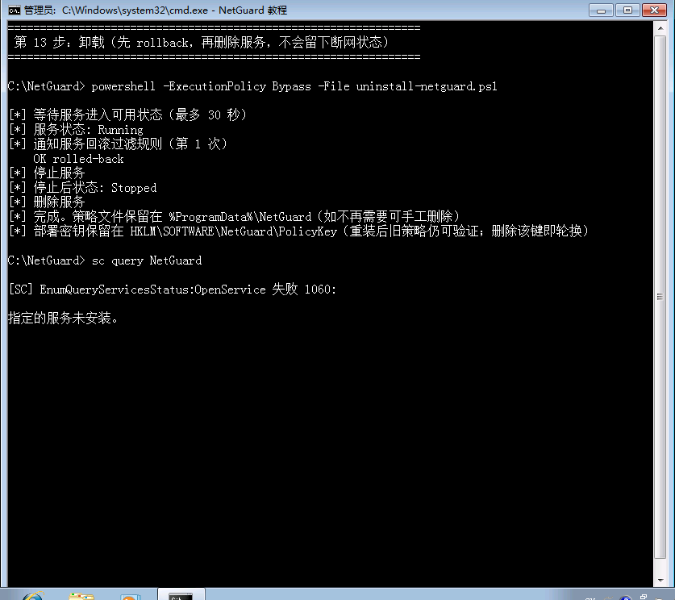

脚本的顺序是：等待服务就绪 → 停止服务 → 通知服务 rollback（撤销全部过滤器）→ 删除服务 → 清理残留进程。

所以卸载完**立刻恢复联网**，不会留下“服务删了但过滤器还在”的断网状态。

注意：

- `C:\ProgramData\NetGuard\policy.ini` 会保留（重装可直接复用）；
- 部署密钥保留在 `HKLM\SOFTWARE\NetGuard\PolicyKey`；
- 彻底清理：确认不再使用后，手工删除上面两个位置。

---

## 18. 常见问题（照着查）

| 现象 | 原因 / 解决 |
|---|---|
| 提示“需要管理员权限” | 命令提示符不是管理员。按第 2 步重新打开，标题要有“管理员:” |
| `无法加载文件 ... 禁止运行脚本` | 用教程里的写法：`powershell -ExecutionPolicy Bypass -File xxx.ps1` |
| `策略签名校验失败` / `密钥缺失` | 策略被手工改过或来自别的机器。用界面重新“保存并应用”；或管理员执行 `NetGuard.exe sign` |
| 业务程序升级后连不上 | 文件哈希变了，白名单被撤销。在界面里重新选程序（重算哈希）并保存 |
| 装完远程桌面连不上 | 正常（默认拒绝）。到场后用界面「临时放行」，或提前把维护机加进白名单 |
| 临时放行到时间没恢复 | 服务是否在运行？`sc query NetGuard`；看 `ng.log` 最后几行 |
| 服务起不来 | 看 `C:\ProgramData\NetGuard\ng.log`、`install.log`；再执行 `sc query NetGuard` |
| 过滤器条数比预期少 | 业务程序路径不存在 / 已停用 / 哈希不匹配。看 `audit.log` 的 ALERT |
| 界面口令忘了 | 管理员删除 `C:\ProgramData\NetGuard\admin.dat`，重新打开界面设置 |
| 怎么知道试用还剩几天 | `NetGuard.exe trial`，或看主界面底部状态栏 |
| 试用到期会断网吗 | 不会。服务会自动撤销过滤器、恢复联网；只是不再管控 |
| 试用到期后 `apply` 报错 | 正常。需要更换正式授权版本 |
| 重装能重置试用吗 | 一般不会：`TrialStart` 保留在注册表里；故意删除该键可以重置，仅用于测试 |
| 卸载后还是上不了网 | 先执行 `NetGuard.exe ctl rollback`（或 `rollback`），再确认 `filters.txt` 为空 |
| Win7 上 PowerShell 报参数不存在 | Win7 自带 PowerShell 2.0；本教程脚本已兼容，不要自己加 `-File`、`-Tail` 等新参数 |

---

## 19. 命令速查

| 命令 | 作用 |
|---|---|
| `NetGuard.exe initpolicy` | 生成示例策略（同时确保密钥存在） |
| `NetGuard.exe initkey` | 生成/检查部署密钥 |
| `NetGuard.exe verify` | 校验签名和格式（不下发） |
| `NetGuard.exe sign` | 手工改过策略后重新签名（需管理员） |
| `NetGuard.exe test` | 端到端自测（临时断网几秒） |
| `NetGuard.exe selftest` | 只做“应该被拦”的自检 |
| `NetGuard.exe status` | 看策略 + 生效过滤器条数 |
| `NetGuard.exe trial` | 看 60 天试用期剩余天数 |
| `NetGuard.exe install` | 只装服务（一般用 install-netguard.ps1） |
| `NetGuard.exe ctl apply` | 让服务立即按当前策略下发 |
| `NetGuard.exe ctl rollback` | 撤销全部过滤器（恢复联网） |
| `NetGuard.exe ctl temp 30` | 临时放行 30 分钟 |
| `NetGuard.exe ctl status` | 问服务要运行状态（ASCII，适合脚本） |
| `NetGuard.exe hash <文件>` | 计算 SHA-256 |
| `NetGuard.exe uninstall` | 只删服务（一般用 uninstall-netguard.ps1） |

---

## 20. 上线检查清单

- [ ] 先在备用机/虚拟机跑通全流程（含 `test`）
- [ ] 记录终端原来的 IP/DNS/网关，留好回滚方案
- [ ] 业务地址、端口、协议、程序路径核对无误
- [ ] 业务程序 SHA-256 已锁定
- [ ] 远程维护方式已确定（临时放行 / 现场）
- [ ] 界面管理员口令已改成强口令
- [ ] 上线后观察 `audit.log` / `ng.log` 至少一天
- [ ] 演练一次 `ctl rollback`，确认能恢复联网
- [ ] 再演练一次 `ctl apply`，确认管控能回来

---

> 本文所有截图均来自 Win7 SP1 x64。
> 示例中的 IP、程序名、口令只用于演示，现场请替换成自己的。
